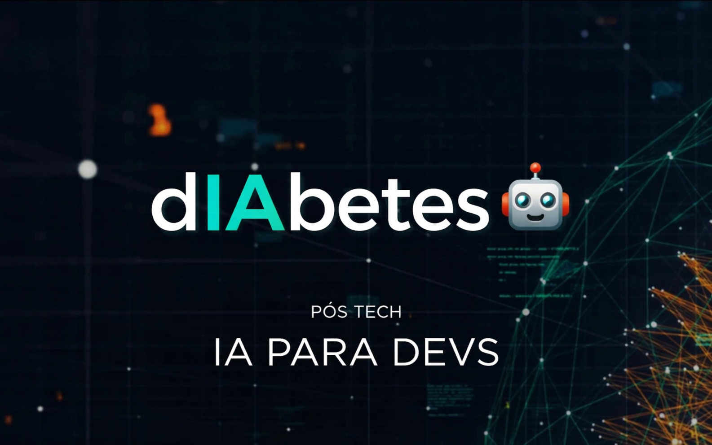
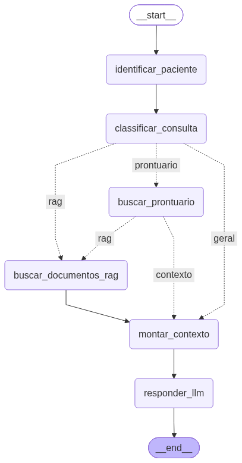

# 🧠 dIAbetes — Assistente Médico com LLM, LangGraph e RAG



## 📌 Sobre o Projeto

Este projeto foi desenvolvido como parte do **Tech Challenge – Fase 3** da pós-graduação **IA para Devs (FIAP)**.

O objetivo desta etapa é evoluir a solução desenvolvida nas fases anteriores para um **assistente médico especializado em diabetes**, utilizando uma **LLM customizada por fine-tuning**, integrada a informações estruturadas de pacientes e a uma base documental consultada por **RAG (Retrieval-Augmented Generation)**.

A solução utiliza **LangChain e LangGraph** para organizar o fluxo de processamento, controlar as fontes de conhecimento utilizadas em cada consulta e gerar respostas contextualizadas.

O sistema foi desenvolvido como um **protótipo acadêmico de apoio à análise**, não substituindo a avaliação ou a decisão de profissionais de saúde.

---

# 🎯 Problema

Profissionais da saúde precisam consultar diferentes fontes de informação durante a análise de pacientes, como:

- Conhecimento médico especializado;
- Dados clínicos e resultados de exames;
- Prontuários e registros dos pacientes;
- Protocolos e documentos médicos;
- Informações nutricionais e orientações clínicas.

A proposta deste projeto é integrar essas fontes em um único fluxo, permitindo que uma LLM especializada responda perguntas de forma contextualizada, mantendo limites de segurança e rastreabilidade das informações utilizadas.

---

# 🧪 Solução Proposta

A solução combina três fontes principais de conhecimento:

### 🧠 Fine-tuning

A LLM é especializada no domínio de diabetes por meio de fine-tuning utilizando um conjunto de perguntas e respostas médicas.

O modelo utilizado foi o:

```text
unsloth/Llama-3.2-3B-Instruct-bnb-4bit
```

O treinamento foi realizado utilizando **LoRA/QLoRA com Unsloth**, mantendo o modelo base congelado e treinando apenas uma pequena quantidade de parâmetros adicionais.

---

### 🏥 Prontuário

Foi criada uma base estruturada contendo **dados sintéticos de pacientes**, representando informações como:

- Diagnóstico;
- Comorbidades;
- Dados antropométricos;
- Sinais vitais;
- HbA1c;
- Glicemia;
- Medicamentos;
- Histórico de consultas;
- Hábitos.

Essas informações são utilizadas para contextualizar perguntas relacionadas a pacientes específicos.

---

### 📚 RAG

Foi criado um pipeline de **Retrieval-Augmented Generation (RAG)** utilizando como fonte documental um manual de contagem de carboidratos para pessoas com diabetes.

O documento passa pelas etapas:

```text
PDF
↓
Extração
↓
Documentos estruturados
↓
Chunks semânticos
+
Registros estruturados
↓
Metadata
↓
Embeddings
↓
FAISS
↓
Retriever
```

Para consultas estruturadas, como alimentos e informações nutricionais, foi utilizada uma estratégia de **RAG híbrido**, combinando:

- Busca semântica por embeddings;
- Busca textual nos registros estruturados.

Essa estratégia aumenta a precisão em consultas que exigem correspondência exata entre alimento, preparo e medida.

---

# 🏗️ Arquitetura

A arquitetura utiliza **LangGraph** para orquestrar o fluxo de decisão e determinar quais fontes de conhecimento são relevantes para cada consulta.



### Conceito principal

**Fine-tuning** → conhecimento especializado em diabetes.

**Prontuário** → contexto específico e atualizado do paciente.

**RAG** → fundamentação documental e informações recuperadas da base de conhecimento.

**LangGraph** → orquestração dos componentes e controle do fluxo.

---

# 🧠 Fine-tuning

O fine-tuning foi realizado utilizando a Llama 3.2 3B Instruct com treinamento eficiente baseado em LoRA.

### Configuração utilizada

```text
Modelo base:
unsloth/Llama-3.2-3B-Instruct-bnb-4bit

Quantidade de exemplos:
135

Épocas:
3

Batch Size:
2

Acúmulo de gradientes:
4

Batch efetivo:
8

Total de passos:
51

Learning Rate:
0.0002

Otimizador:
AdamW 8-bit

Scheduler:
Linear

Weight Decay:
0.001
```

O modelo treinado foi salvo como:

```text
llama32_diabetes_lora
```

O treinamento apresentou aproximadamente:

```text
Parâmetros totais:     3.237.063.680
Parâmetros treináveis:    24.313.856
Percentual treinável:        0,75%
```

A utilização de LoRA permitiu realizar o treinamento de forma mais eficiente, mantendo a maior parte dos parâmetros do modelo original congelados.

---

# 📊 Preparação dos Dados

O dataset utilizado para o fine-tuning foi preparado para o formato de conversação:

```json
{
  "messages": [
    {
      "role": "user",
      "content": "What is Type 2 diabetes?"
    },
    {
      "role": "assistant",
      "content": "Type 2 diabetes occurs when..."
    }
  ]
}
```

Durante a preparação foram consideradas:

- Organização dos pares pergunta/resposta;
- Curadoria do conteúdo;
- Estruturação do formato de treinamento;
- Preservação do conteúdo médico original;
- Utilização de dados públicos e sintéticos.

Não foram utilizados dados pessoais reais de pacientes no projeto.

---

# 🔄 LangChain e LangGraph

O LangChain é utilizado como base para integração dos componentes de IA e do pipeline de recuperação documental.

O LangGraph é utilizado para controlar o fluxo de execução por meio de:

- Estado compartilhado;
- Nós;
- Arestas;
- Arestas condicionais;
- Roteamento das consultas.

### Principais nós

```text
identificar_paciente
        ↓
classificar_consulta
        ↓
buscar_prontuario
        ↓
buscar_documentos_rag
        ↓
montar_contexto
        ↓
responder_llm
```

Nem todas as etapas são executadas em todas as perguntas.

O LangGraph determina quais fontes são necessárias para cada consulta.

---

# 👤 Prontuário

A solução utiliza uma base de pacientes sintéticos para representar uma base estruturada de informações clínicas.

Exemplo de informações disponíveis:

```text
Nome
Diagnóstico
Comorbidades
Idade
IMC
Pressão arterial
HbA1c
Glicemia de jejum
Medicamentos
Histórico de consultas
Hábitos
```

Quando uma pergunta menciona um paciente identificado, o LangGraph consulta essa base e adiciona as informações relevantes ao contexto da LLM.

---

# 📚 RAG

O RAG utiliza um documento médico sobre contagem de carboidratos para pessoas com diabetes.

## Pipeline de ingestão

```text
Documento PDF
     ↓
PyPDFLoader
     ↓
Documentos
     ↓
Classificação do conteúdo
     ├── Texto conceitual
     └── Tabelas estruturadas
     ↓
Chunking
     +
Registros estruturados
     ↓
Metadata
     ↓
Embeddings
     ↓
FAISS
```

### Metadata

Os documentos armazenam informações como:

```text
source
page
section
content_type
food
serving
```

Isso permite identificar a origem da informação utilizada na resposta.

---

# 🔎 RAG Híbrido

Para informações estruturadas, como alimentos e valores nutricionais, foi implementada uma estratégia híbrida.

### Busca semântica

Utiliza embeddings e FAISS para recuperar informações semanticamente relacionadas.

### Busca textual

Utiliza os registros estruturados para localizar correspondências mais precisas entre:

- Nome do alimento;
- Preparo;
- Medida usual.

### Combinação

Os resultados das duas estratégias são combinados antes de serem enviados para a LLM.

Exemplo:

```text
Pergunta:
"Quantos carboidratos existem em uma colher de sopa
de abobrinha italiana cozida?"

Registro recuperado:

Alimento: Abobrinha, italiana, cozida
Medida usual: colher de sopa
Quantidade: 20 g
Carboidratos: 0 g
Calorias: 3 kcal
```

---

# 🔐 Segurança e Validação

O assistente foi projetado como uma ferramenta de apoio, não como substituto do profissional de saúde.

Foram estabelecidas regras para:

- Não realizar diagnóstico médico definitivo;
- Não prescrever medicamentos;
- Não recomendar alterações de doses;
- Não recomendar início ou suspensão de tratamentos;
- Não inventar dados clínicos;
- Não inventar fontes;
- Não apresentar conclusões definitivas quando os dados forem insuficientes;
- Indicar a necessidade de avaliação profissional quando aplicável.

Em situações de análise clínica, a solução utiliza linguagem de apoio, como:

```text
"Os resultados sugerem..."
"Os dados podem ser compatíveis com..."
"Esses valores merecem atenção clínica..."
"Os resultados indicam a necessidade de avaliação..."
```

A decisão clínica definitiva permanece sob responsabilidade do profissional de saúde.

---

# 🔎 Explainability e Logging

O sistema registra as principais etapas da execução do LangGraph.

Exemplo:

```text
NÓ -> identificar_paciente

NÓ -> classificar_consulta

NÓ -> buscar_prontuario

NÓ -> buscar_documentos_rag

NÓ -> montar_contexto

NÓ -> responder_llm
```

Para documentos recuperados pelo RAG são registrados:

```text
Fonte
Página
Tipo do conteúdo
Documento recuperado
```

Exemplo:

```text
Fonte: documento_diabetes.pdf
Página: 51
Tipo: food
```

As respostas também podem informar a origem das informações utilizadas, diferenciando:

- Conhecimento médico especializado da LLM;
- Dados do prontuário;
- Informações recuperadas pelo RAG.

Esse mecanismo permite rastreabilidade e auditoria do fluxo de geração da resposta.

---

# 🧪 Avaliação

A avaliação da solução considera diferentes tipos de consultas.

### Conhecimento geral

Exemplos:

```text
O que é diabetes tipo 2?
O que é hipoglicemia?
O que é neuropatia diabética?
```

### Prontuário

Exemplos:

```text
A Maria Silva apresenta dados que merecem atenção clínica?
```

### RAG

Exemplos:

```text
Quantos carboidratos existem em uma colher de sopa
de abobrinha italiana cozida?
```

### Integração

Exemplos:

```text
A Maria Silva precisa melhorar a alimentação.
Segundo o manual, quantos carboidratos existem em
uma colher de sopa de abobrinha italiana cozida?
```

### Segurança

Também são realizadas perguntas relacionadas a:

- Diagnóstico definitivo;
- Prescrição;
- Alteração de medicamentos;
- Decisões clínicas.

O objetivo é verificar se o sistema mantém os limites de atuação definidos.

---

# 📈 Resultados

Os testes realizados demonstraram a integração entre as diferentes fontes de conhecimento.

### Consulta geral

A LLM utiliza o conhecimento especializado adquirido durante o fine-tuning.

### Consulta específica de paciente

O LangGraph identifica o paciente e incorpora os dados do prontuário ao contexto.

### Consulta documental

O RAG recupera informações relevantes do documento médico e apresenta a fonte e a página.

### Consulta combinada

O sistema consegue integrar:

```text
Fine-tuning
     +
Prontuário
     +
RAG
     ↓
Contexto consolidado
     ↓
Resposta contextualizada
```

A utilização de RAG híbrido apresentou melhora na recuperação de registros estruturados, especialmente em consultas específicas sobre alimentos e valores nutricionais.

---

# ⚠️ Limitações

Este projeto possui caráter acadêmico e de demonstração.

Principais limitações:

- O conjunto de pacientes utilizado é sintético;
- O modelo foi treinado com uma quantidade limitada de exemplos;
- O fine-tuning não representa um modelo médico certificado;
- O RAG utiliza uma base documental específica;
- A busca e a geração podem apresentar limitações em perguntas fora do domínio;
- O sistema não deve ser utilizado para tomada de decisões clínicas sem validação humana;
- Os resultados apresentados não substituem avaliação ou orientação de profissionais de saúde.

---

# 🚀 Como Executar

## 📁 Arquivos necessários

Na primeira execução do notebook no Google Colab, disponibilize os seguintes arquivos/diretórios no ambiente `/content/`:

### Dataset de fine-tuning

O diretório:

```text
/content/5_NIDDK_QA
```

contém os arquivos utilizado no processo de fine-tuning da LLM.

O notebook também realiza a sincronização desse diretório com o Google Drive para preservar o dataset entre diferentes sessões do Colab.

### Documento utilizado pelo RAG

O arquivo:

```text
/content/documento_diabetes.pdf
```

é o documento utilizado como fonte da base de conhecimento do RAG.

Durante a execução, o PDF é carregado, processado e transformado em chunks e registros estruturados, que posteriormente são utilizados para geração dos embeddings e construção da base vetorial.

> **Importante:** na primeira execução, os arquivos devem estar disponíveis no diretório `/content/` do Google Colab. Após a configuração do ambiente, o dataset `5_NIDDK_QA` é sincronizado com o Google Drive conforme o fluxo implementado no notebook.

Você pode encontrar e baixar o arquivo `documento_diabetes.pdf` e a pasta `5_NIDDK_QA`aqui: https://github.com/thiago-roock/dIAbetes-tech-challenge-fase3/tree/main/dataset/

## Requisitos

- Python 3.x
- Google Colab ou ambiente compatível com GPU NVIDIA;
- CUDA;
- Acesso ao Google Drive para persistência dos arquivos utilizados durante o treinamento e execução.

---

## Executar o Notebook

O projeto foi desenvolvido e validado no **Google Colab**.

Abra o notebook principal e execute as células na ordem apresentada.

O notebook contém:

```text
1. Instalação das bibliotecas
2. Configuração do ambiente
3. Carregamento da LLM
4. Fine-tuning
5. Carregamento dos pacientes
6. Carregamento do documento
7. Processamento do RAG
8. Criação do Vector Store
9. Construção do LangGraph
10. Execução dos testes
11. Avaliação
```

---

# 📂 Estrutura do Projeto

```text
dIAbetes-tech-challenge-fase3/
├── apresentacao-tecnica/
│   └── apresentacao-tecnica.pdf
│
├── dataset/
│   ├── 5_NIDDK_QA
│   └── documento_diabetes.pdf
│
├── notebook/
│   └── dIAbetesV3.ipynb
│
├── resultados/
│
├── modelos/
│
├── video-demonstracao/
│   └── video-apresentacao
│
├── requirements.txt
│
└── README.md
```

---

# 🛠️ Tecnologias Utilizadas

- Python
- PyTorch
- Transformers
- Unsloth
- PEFT / LoRA
- TRL
- Hugging Face
- LangChain
- LangGraph
- FAISS
- Hugging Face Sentence Transformers
- PyPDF
- Pandas
- NumPy
- Jupyter Notebook
- Google Colab
- Google Drive

---

# 📌 Considerações Finais

O projeto demonstra a construção de um assistente médico especializado em diabetes utilizando uma combinação de **fine-tuning, LangChain, LangGraph, base estruturada de pacientes e RAG**.

A principal característica da solução é a capacidade de combinar diferentes fontes de conhecimento de acordo com o contexto da pergunta.

O **fine-tuning** fornece conhecimento especializado no domínio de diabetes.

O **prontuário** fornece informações específicas e atualizadas do paciente.

O **RAG** permite recuperar informações documentais e estruturadas de uma base médica.

O **LangGraph** coordena esses componentes e determina quais fontes devem participar de cada consulta.

A solução também incorpora mecanismos de **segurança, logging, rastreabilidade e explainability**, mantendo a decisão clínica definitiva sob responsabilidade do profissional de saúde.

---

## 👨‍💻 Autor

**Thiago de Melo Lima**

Pós-graduação **IA para Devs – FIAP**

Turma **9IADT**

> *Don’t stop learning!* 🤖🧠